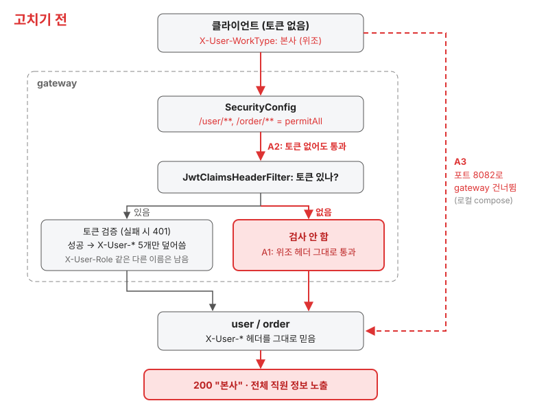
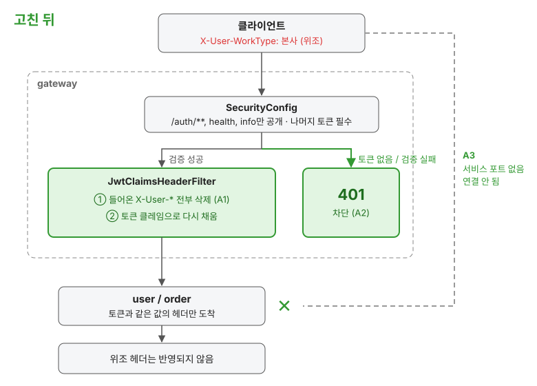

# A1~A3. gateway 헤더 위조·인증 우회 (GEA-8)

## 발견

user·order는 JWT를 직접 보지 않고, gateway가 붙여주는 `X-User-*` 헤더(Id, Name, Rank, Region, WorkType)만 보고 누가 요청했는지 판단해요.

고치기 전 흐름 (빨간색이 뚫린 경로):

- **A2**: `SecurityConfig`가 `/user/**`, `/order/**`를 `permitAll`로 열었고, `JwtClaimsHeaderFilter`는 토큰이 없으면 검사 없이 넘겼어요. 토큰을 보내면 검증하지만, 안 보내면 아무도 막지 않았어요.
- **A1**: 필터가 클라이언트의 `X-User-*`를 지우지 않았어요. 토큰 없이 서비스까지 닿으니(A2), 위조한 헤더가 그대로 도착했어요. 토큰을 보내는 경우엔 5개가 덮어써져서 막혔지만, `X-User-Role`처럼 5개에 없는 이름은 살아남았어요.
- **A3**: 로컬 compose(GEA-5에서 우리가 만든 것)가 auth·user·order의 호스트 포트를 열어 gateway를 건너뛸 수 있었어요. 원본 운영(GKE)은 ClusterIP였을 가능성이 높아 원본 취약점이라기보다 로컬 환경의 구멍이에요. 운영 설정(GitOps 레포)은 확인하지 않았어요.

재현: 토큰 없이 `X-User-WorkType: base64(본사)`만 붙여 `/user/api/v1/me` → 200 "본사". `/user/api/v1/getAllUser` → 전체 직원 이름·이메일·전화번호 200.

## 선택지

| | 방법 | 장점 | 단점 |
|---|---|---|---|
| 1 | gateway에서 인증 필수 + 헤더 삭제 후 재주입 + 서비스 포트 닫기 | gateway 한 곳만 고침 | 내부망에서는 헤더 위조 가능 |
| 2 | user·order가 JWT를 직접 검증(zero trust) | 내부망 위조도 막음 | 두 서비스의 인증 구조를 모두 바꿈 |
| 3 | 1 + Kubernetes NetworkPolicy(user·order엔 gateway만 접근) | 코드 변경 없이 내부망 경로 축소 | 배포 환경에 달려 있어 로컬에서 증명 불가 |

## 선택: 1

외부 공격(A1~A3)을 막는 게 먼저였고, 고칠 곳이 gateway 하나라 범위가 작아요. 셋을 같이 막았어요. 하나만 막으면 남은 쪽으로 뚫려요.

- 인증 필수(A2): `permitAll`을 토큰 받기 전에 써야 하는 곳(`/auth/**`, `/actuator/health/**`, `/actuator/info`)으로 줄이고 나머지는 `authenticated()`.
- 헤더 삭제(A1): 필터 맨 앞에서 `X-User-`로 시작하는 헤더를 대소문자 무시하고 전부 지운 뒤, 검증된 토큰 클레임으로만 다시 채워요. 5개만 덮어쓰면 나중에 서비스가 새 이름을 읽기 시작할 때 구멍이 돼요.
- 포트 닫기(A3): compose에서 auth·user·order의 `ports:` 제거. gateway(8080)만 입구.

고친 뒤 흐름:

## 한계

- **내부망 위조**: user·order는 "gateway를 거쳐 왔으면 헤더는 진짜"라고 믿어요. 헤더에 서명이 없어서, 같은 네트워크의 다른 컨테이너·Pod가 털리면 user에 직접 위조 헤더를 보낼 수 있어요. 막으려면 선택지 2나 3.
- **인가 없음**: 이제 "로그인했는지"만 봐요. 사원도 전체 직원 조회, 본사 팀장 계정 생성이 가능해요 → B1~B2.
- **`/auth/**` 통째 공개**: auth 안의 개별 엔드포인트는 auth 보안 설정에 맡겼는데, 거기서 `regenerate-temp-password`, `delete`, `change-password`, `signup`이 permitAll이라 외부에서 gateway를 통해 호출돼요 → C1~C3, signup 후보.
- **운영 미확인**: 포트를 닫은 건 로컬 compose뿐. 운영 ClusterIP·NetworkPolicy는 배포 단계에서 확인.
- **남겨 둔 것**: 필터가 JWT 원문을 ERROR 로그로 출력(E2). 토큰을 Spring Security와 필터에서 두 번 검증(E2 때 정리).

## 증명

- `gateway/src/test/java/com/gearfirst/gateway/HeaderSpoofingTest.java` 6개 중 5개가 고치기 전 실패 → 고친 뒤 통과(잘못된 토큰 401은 원래 통과). 가짜 토큰 검증기와 받은 헤더를 돌려주는 테스트용 엔드포인트를 써서 "gateway가 무엇을 내려보내는지"만 확인해요. 실제 user·order까지는 로컬 compose에서 손으로 확인.

| 공격 | 고치기 전 | 고친 뒤 |
|---|---|---|
| 토큰 없이 위조 헤더로 `/user/api/v1/me` | 200 "본사" | 401 |
| 토큰 없이 `/user/api/v1/getAllUser` | 200, 전체 직원 정보 | 401 |
| 토큰 없이 위조 헤더로 본사 발주 목록 | 200 | 401 |
| gateway 건너뛰고 user에 직접(8082) | 200 | 연결 안 됨 |
| 토큰 + 위조 `X-User-WorkType: 창고` | - | 토큰 값("본사")만 반영 |

PR: gearfirst-v2/gearfirst#4
