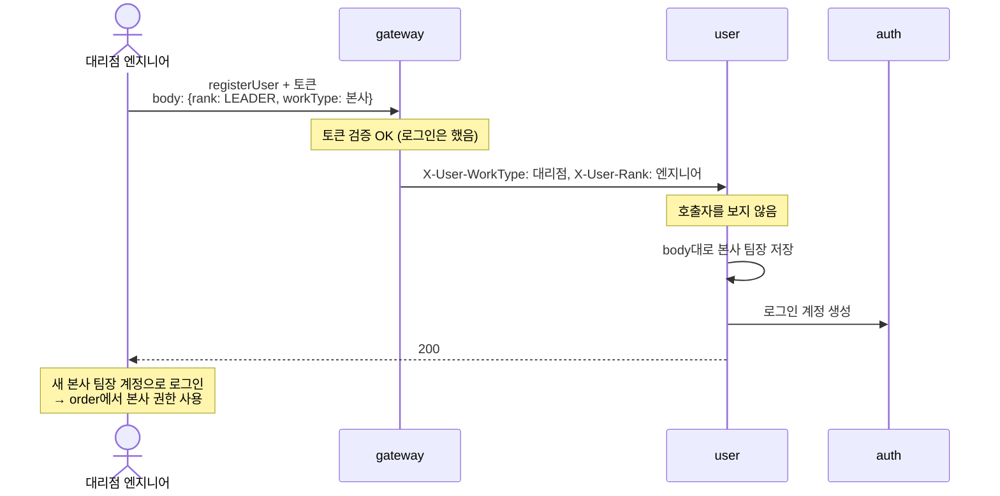
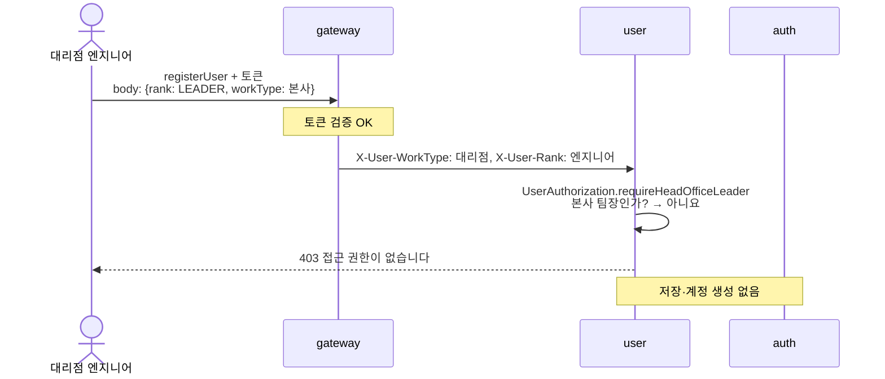
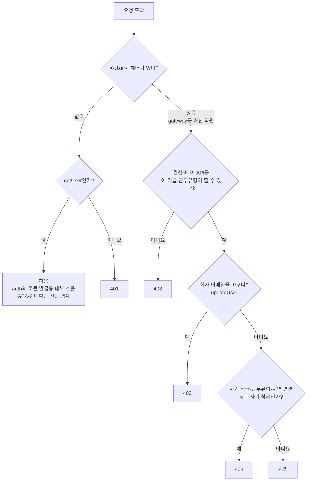
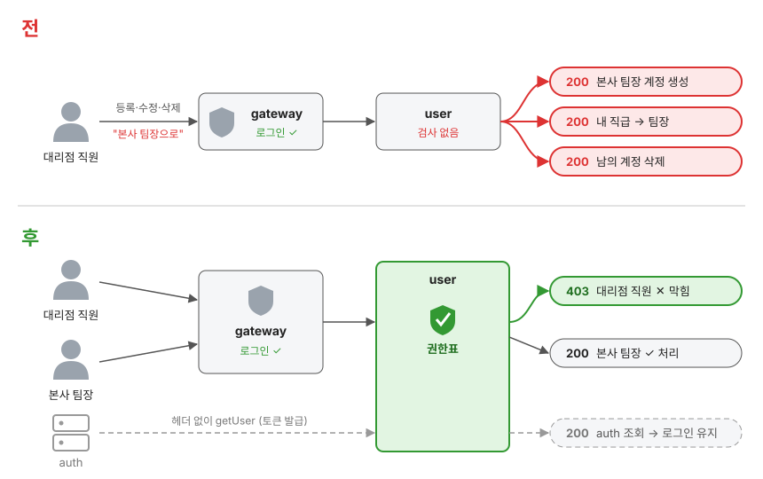

# B1·B2. user API에 인가 검사가 없음 (GEA-15)

## 발견

GEA-8로 gateway가 토큰을 강제하면서 "로그인했는지"(인증)는 막았어요. 하지만 user는 "그 사람이 이걸 해도 되는지"(인가)를 전혀 보지 않았어요. 로그인한 직원이면 누구나 모든 user API를 부를 수 있었어요.

| 라벨 | API | 문제 |
|---|---|---|
| B1 | `POST /user/api/v1/registerUser` | 대리점 엔지니어도 body에 `rank: LEADER`, `workTypeId: 본사`를 넣으면 본사 팀장 계정이 생겨요. 그 계정으로 로그인하면 order에서 본사 권한을 써요(권한 상승) |
| B2 | `POST /user/api/v1/updateUser` | 아무 직원이나 고칠 수 있어요. **자기 직급을 팀장, 근무유형을 본사로** 바꿀 수도 있어요 |
| B2 | `DELETE /user/api/v1/deleteUser` | 아무 직원이나 지울 수 있어요. auth 로그인 계정도 같이 지워져요 |
| (같은 원인) | `getAllUser`, `getUser` | 모든 직원의 이름, 전화번호, 이메일을 볼 수 있어요 |

함께 생긴 문제: GEA-8 이후에는 계정을 만들려면 토큰이 필요해요. 그래서 빈 DB에서는 **첫 본사 계정을 만들 방법이 없어요.**

재현: 권한표를 그대로 옮긴 매트릭스 테스트를 먼저 썼어요. 고치기 전 코드에서 테스트 60개 중 35개가 실패했어요. 403이어야 할 25개(권한표 20칸, B1·B2 재현 5개)가 200, 401이어야 할 10개가 200이었어요. 500 같은 다른 실패는 없었어요.

## 고치기 전과 후

### 전: 로그인만 하면 통과

대리점 엔지니어가 등록 요청 body에 본사 팀장 값을 넣어요(B1). user는 "누가 보냈는지"를 보지 않고 body대로 만들어요.

`updateUser`(자기 직급을 팀장으로), `deleteUser`(남의 계정 삭제)도 같은 모양이에요(B2).

### 후: 호출자 헤더로 권한표 검사

같은 요청이 user의 첫 줄에서 403으로 멈춰요. DB 저장과 auth 호출은 실행되지 않아요.

### 후: user가 요청을 판단하는 순서

외부 요청은 gateway가 항상 헤더를 붙여서 "헤더 없음" 갈래로 들어올 수 없어요. 본인 `getUser`는 권한표에서 누구나 O라서 "예"로 통과해요.

### 한눈에 보기

## 권한표

호출자 정보는 gateway가 토큰 클레임으로 넣는 `X-User-*` 헤더예요. 직급과 근무유형은 한글 이름(`팀장`, `본사`)으로 와요.

| API | 본사 팀장 | 본사 사원 | 창고 | 대리점 |
|---|---|---|---|---|
| `registerUser` | O | X | X | X |
| `getAllUser` | O | O | X | X |
| `getUser` 남의 정보 | O | O | X | X |
| `getUser` 본인 | O | O | O | O |
| `updateUser` 남의 정보 | O | X | X | X |
| `updateUser` 본인 | O(이름·전화만) | X | X | X |
| `deleteUser` 남 | O | X | X | X |
| `deleteUser` 본인 | X | X | X | X |
| `me`, `getRegion`, `getWorkType` | O | O | O | O |

- X는 403, 헤더가 없으면 401이에요. 예외는 아래 "auth의 getUser 호출"이에요.
- 본사 팀장도 자기 직급, 근무유형, 지역은 못 바꾸고(403), 자기 자신은 못 지워요(403). 마지막 본사 팀장이 사라지지 않게 하려는 거예요.
- 회사 이메일은 누구도 못 바꿔요(400). auth의 로그인 이메일과 어긋나지 않게 하려는 거예요. 회사 이메일은 퇴사할 때까지 바뀔 일이 없어요.
- 알 수 없는 직급 헤더(예: `회장`)는 팀장이 아니므로 403이에요.

## 선택지와 선택 이유

### 무엇으로 판단하나

| 방법 | 장점 | 단점 |
|---|---|---|
| **X-User-* 헤더(토큰 클레임) ← 선택** | 추가 조회가 없어요. user, order가 같은 기준을 써요 | 강등돼도 토큰이 끝날 때까지(최대 30분) 예전 권한이 남아요 |
| 매 요청 DB 조회 | 강등이 바로 반영돼요 | user만 기준이 달라져요. order는 여전히 헤더를 써요 |
| 쓰기 API만 DB 재확인 | 위험한 작업만 최신 권한으로 막아요 | 판단 기준이 두 갈래가 돼요 |

모든 서비스가 같은 기준을 쓰는 걸 골랐어요. 30분 지연은 토큰 폐기(known-issues 후보)와 같은 문제라 그쪽에서 함께 풀어요.

### 어디서 검사하나

| 방법 | 장점 | 단점 |
|---|---|---|
| **서비스 안의 권한 클래스 + if문 ← 선택** | "본인인가", "대상이 누구인가"처럼 대상 데이터가 필요한 검사를 할 수 있어요. 새 의존성이 없어요 | 메서드마다 직접 불러야 해요 |
| `@PreAuthorize` | 선언형이라 한눈에 보여요 | user에 Spring Security를 넣어야 해요. GEA-13에서 API 전체에 기본 로그인이 걸리는 걸 피하려고 일부러 넣지 않았어요 |
| 인터셉터 + 어노테이션 | 컨트롤러에 붙이기만 하면 돼요 | 본인 여부처럼 대상을 봐야 하는 검사를 못 해요 |

구현: `UserAuthorization`이 권한표를 코드로 옮긴 곳이에요. `UserService`의 각 메서드 첫 줄에서 불러요.

### auth의 getUser 호출

auth는 토큰을 만들 때 user `getUser`를 **헤더 없이** 불러요(gateway를 거치지 않는 내부 호출). 헤더가 없으면 막는 규칙을 그대로 적용하면 로그인이 깨져요.

| 방법 | 장점 | 단점 |
|---|---|---|
| **헤더 없는 `getUser`만 허용 ← 선택** | auth를 바꾸지 않아요. "검증은 gateway 한 곳에서"라는 GEA-8 원칙과 맞아요 | 내부망 안에서는 헤더 없이 아무 직원 정보나 읽을 수 있어요 |
| auth가 서비스 토큰을 붙이고 user가 검증 | auth → user 호출을 증명해요 | 내부망 공격자는 어차피 X-User-* 헤더를 위조해 모든 API를 부를 수 있어요. 이 길 하나만 막으면 막아지는 게 거의 없어요. user에 JWT 검증이 새로 생겨 원칙과도 어긋나요 |
| zero trust(모든 서비스가 JWT 검증) | 내부망 위조까지 막아요 | GEA-8에서 고르지 않은 선택지예요. 서비스마다 검증이 중복돼요 |

외부 요청은 gateway가 항상 헤더를 붙이므로 "헤더 없음" 칸으로 들어올 수 없어요. 외부 사람이 auth를 시켜 남의 정보를 꺼낼 수도 없어요. auth는 로그인에 성공한 뒤, auth DB에 있는 그 사람 자신의 userId로만 부르기 때문이에요.

### 첫 본사 계정

| 방법 | 장점 | 단점 |
|---|---|---|
| 시드 SQL | 가장 단순해요 | 비밀번호 해시를 레포에 넣어야 해요(C5와 같은 문제). user와 auth DB를 손으로 맞춰야 해요 |
| **시작할 때 환경변수로 생성 ← 선택** | 비밀번호가 어디에도 없어요(임시 비밀번호는 개인 메일로만). 열린 API가 없어요. 등록 로직을 그대로 써서 두 DB가 어긋나지 않아요 | 설정이 틀리면 아무도 못 들어와요 |
| 일회용 설정 토큰 API | 설치 화면 같은 경험을 줘요 | 공격받을 API가 하나 늘고, 먼저 부르는 사람이 이기는 경쟁이 생겨요 |

구현: `HeadOfficeBootstrap`. 본사 팀장이 0명이고 `BOOTSTRAP_ADMIN_EMAIL`, `BOOTSTRAP_ADMIN_PERSONAL_EMAIL`이 있을 때만 만들어요. user가 auth보다 먼저 뜰 수 있어서 3번 다시 시도하고, 그래도 실패하면 ERROR 로그를 남겨요. 실패하면 user 쪽 저장도 롤백되므로 다음 재시작 때 다시 시도해요.

## 한계

- **강등 반영 지연:** 직급이 바뀌어도 토큰이 끝날 때까지(최대 30분) 예전 권한으로 동작해요. 토큰 폐기와 함께 풀어요(known-issues 후보).
- **내부망 신뢰:** 헤더 없는 `getUser`는 내부망 안에서 누구나 부를 수 있어요. 내부망 공격자는 헤더를 위조해 이번 권한 검사도 통과할 수 있어요. 둘 다 A1-A3의 "내부망 위조"와 같은 한계예요([A1-A3](A1-A3-header-spoofing.md)). 배포할 때 NetworkPolicy로 user에는 gateway와 auth만 닿게 좁혀요.
- **부트스트랩 권한:** 서버 환경변수를 바꿀 수 있는 사람은 본사 팀장을 만들 수 있어요. 그 사람은 이미 서버 전체 권한을 가진 사람이에요.
- **프론트 버튼:** 직원 관리 화면은 토큰 클레임을 읽어 버튼만 숨겨요. 서명을 검증하지 않으므로 진짜 차단은 서버의 403이에요.

## 증명

| 테스트 | 내용 | 결과 |
|---|---|---|
| `UserAuthorizationMatrixTest` 권한표 | API·대상 11줄 × 호출자 4종 = 44칸. 허용은 200, 거부는 403 | 통과(고치기 전 20칸 실패) |
| 〃 로그인 없음 | 헤더 없는 요청은 401 (`getUser` 제외 10개) | 통과(고치기 전 9칸 실패) |
| 〃 auth 내부 호출 | 헤더 없는 `getUser`는 200 | 통과 |
| 〃 B1·B2 재현 | 본사 사원·창고·대리점 직급으로 팀장 계정 등록 403, 사원이 자기 직급을 팀장으로 403 | 통과 |
| 〃 자기 자신 보호 | 본사 팀장 자기 직급·근무유형 변경 403, 자기 삭제 403 | 통과 |
| 〃 잘못된 값 | 알 수 없는 직급 헤더 403, 이메일 변경 400, 없는 직원 404 | 통과 |
| `HeadOfficeBootstrapTest` | 본사 팀장이 없으면 생성(auth 계정 포함), 있으면 아무것도 안 함, 설정이 없으면 아무것도 안 함, auth가 계속 실패하면 3번 시도 후 포기하고 user 저장도 남기지 않음 | 통과 |
| frontend `claims.test.ts` | 토큰 클레임 읽기, 버튼 표시 규칙이 권한표와 같음 | 통과 |

user `./gradlew build` 72개, frontend `npm test` 9개, `npm run build` 통과.
