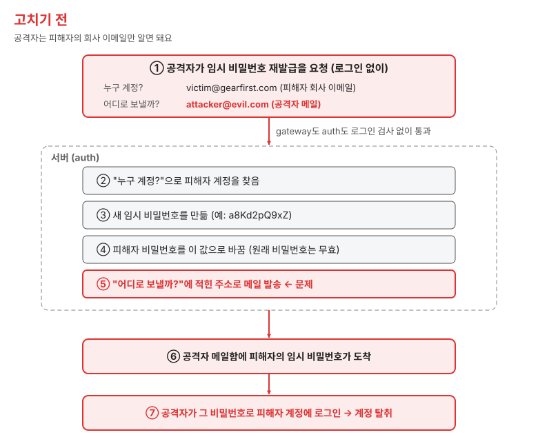
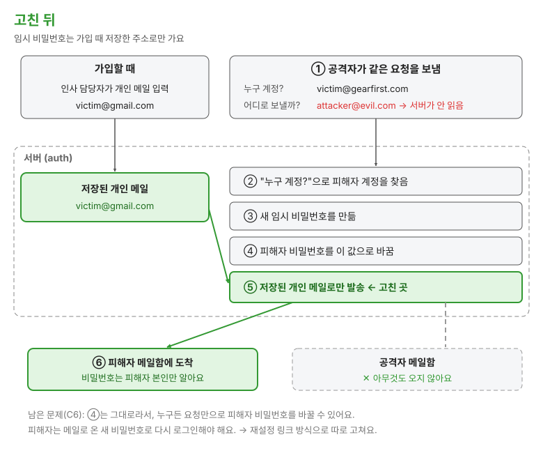

# C1. 임시 비밀번호 재발급으로 계정 탈취 (GEA-12)

## 발견

계정은 인사 담당자가 만들어요. user의 `registerUser`가 auth의 `signup`을 부르면 auth가 임시 비밀번호를 만들어 **개인 이메일**로 보내요. 메일을 못 받았을 때를 위해 `POST /auth/api/v1/auth/regenerate-temp-password`가 있어요.

이 API는 auth `SecurityConfig`에서 permitAll이고, gateway도 `/auth/**`를 통과시켜요. 그래서 로그인 없이 누구나 부를 수 있어요. 게다가 메일을 받을 주소를 **요청 body의 `personalEmail`**에서 가져왔어요. 개인 이메일은 auth에도 user에도 저장되지 않았어요.

고치기 전 흐름 (빨간색이 뚫린 경로):

공격자는 피해자의 회사 이메일만 알면 돼요. 회사 이메일은 보통 추측하기 쉬워요. 공격자가 자기 메일 주소를 넣어 요청하면, 피해자 비밀번호가 바뀌고 새 임시 비밀번호가 공격자에게 가요. 공격자는 그 비밀번호로 피해자로 로그인해요.

재현: GEA-8 때 로컬 compose에서 Mailpit으로 공격자 주소에 피해자 임시 비밀번호가 도착하는 걸 확인했어요. GEA-12에서는 같은 공격을 테스트로 만들었어요(아래 증명).

## 선택지

| | 방법 | 장점 | 단점 |
|---|---|---|---|
| 1 | 가입 때 개인 이메일을 auth에 저장하고, 재발급은 저장된 주소로만 보냄(요청 값 무시) | 원인(요청 값을 믿는 것)을 없앰. 사용자는 회사 이메일만 입력. 요청 형식이 그대로라 호출하는 쪽이 안 깨짐 | 누구나 남의 비밀번호를 새 임시 비밀번호로 바꿀 수 있음(계정 잠금, C6) |
| 2 | 1처럼 저장하고, 요청의 개인 이메일이 저장값과 다르면 거부 | 개인 이메일까지 아는 사람만 요청 가능 | 응답 차이로 개인 이메일이 맞는지 알아낼 수 있음. 사용자가 개인 이메일을 기억해야 함. 개인 이메일은 비밀이 아니라 본인 확인 수단으로 약함 |
| 3 | 1처럼 저장하고, 비밀번호 대신 만료되는 재설정 링크를 보냄. 링크에서 새 비밀번호를 정할 때만 변경 | C1과 계정 잠금(C6)을 같이 막음. 비밀번호가 메일에 평문으로 안 담김 | 토큰 저장·만료·1회 사용 처리, 엔드포인트 2개, 링크를 여는 프론트 화면이 필요. 기존 API를 부르는 쪽이 깨짐 |
| 4 | API를 인증 필수로 바꾸고 인사 담당자만 재발급 | 외부 공격 경로가 사라짐. 원래 의도("메일이 안 오면 인사 담당자가 다시 보냄")와 같음 | 지금은 누구나 본사 팀장 계정을 만들 수 있어서(B1) 역할 검사를 믿을 수 없음. 사용자가 스스로 비밀번호를 찾을 방법이 없어짐 |

실무 사례:
- 관리자가 계정을 만드는 서비스는 다시 보내기를 **관리자 콘솔**에서 해요(Google Workspace, Okta).
- 사용자 셀프 서비스는 **등록된 주소**로만 보내요(Okta 활성화 링크 재요청).
- 비밀번호 찾기는 만료되는 일회용 재설정 링크가 표준이에요(OWASP Forgot Password Cheat Sheet).
- 로그인하지 않은 요청이 보낸 주소로 보내는 곳은 찾지 못했어요.

## 선택: 1

- C1의 원인은 "로그인하지 않은 요청이 보낸 주소를 믿는 것"이고, 1번은 그 원인만 정확히 없애요.
- 3번과 4번도 "개인 이메일을 저장하고 저장된 주소로만 보낸다"가 먼저 필요해요. 그래서 1번은 나중에 버릴 코드가 아니라 다음 단계의 토대예요.
- 요청 형식이 그대로라 프론트가 깨지지 않아요. 프론트가 계속 `personalEmail`을 보내도 무시돼요.
- 2번은 새 위험(개인 이메일 확인)이 생기고, 4번은 B1이 먼저 고쳐져야 의미가 있어서 고르지 않았어요. 3번이 가장 안전하지만 범위가 커서 다음 단계로 미뤘어요(한계 참고).

바꾼 것:
- `Auth`에 `personal_email` 컬럼(nullable) 추가, `createAccount`에서 저장
- `regenerateTempPassword(email)`: 요청의 개인 이메일을 받지 않고 `auth.getPersonalEmail()`로만 발송. 저장값이 없으면 400 `NOT_REGISTERED_PERSONAL_EMAIL_EXCEPTION`
- `RegenerateTempPasswordRequest`에서 `personalEmail` 제거, 컨트롤러에 `@Valid` 추가(빈 이메일 → 400)

고친 뒤 흐름:

## 한계

- **계정 잠금(C6)**: 요청만으로 비밀번호를 즉시 바꾸는 동작은 그대로예요. 회사 이메일만 알면 누구든 남의 비밀번호를 무효로 만들 수 있고, 반복하면 피해자 개인 메일함에 메일이 쌓여요. 원인은 (가) 누구나 부를 수 있고 (나) 본인 확인 없이 바로 바꾸는 것이에요. 실무처럼 기능을 둘로 나눠 고쳐요.
  - 인사 담당자 다시 보내기: 이 API를 인사 담당자만 부르게 해요(선택지 4). B1·B2(역할 검사)를 먼저 고쳐야 하고, 잘못 입력한 개인 이메일을 고치는 기능도 같이 필요해요.
  - 사용자 비밀번호 찾기: 저장된 개인 이메일로 재설정 링크를 보내고, 링크에서 새 비밀번호를 정할 때만 바꿔요(선택지 3). 요청 횟수 제한도 넣어요.
- **기존 계정**: 이 변경 전에 만든 계정은 개인 이메일이 비어 있어서 재발급이 400으로 거부돼요. 지금은 로컬 데이터뿐이라 다시 가입시키면 돼요. 운영 데이터가 있다면 user 쪽 원본에서 채워 넣는 작업이 필요해요.
- **가입 여부 노출**: 없는 이메일은 404, 있으면 201이라 응답으로 가입 여부를 알 수 있어요. 기존 동작이라 이번에는 바꾸지 않았어요. 선택지 3으로 바꿀 때 항상 같은 응답을 주게 해요.
- **메일 발송 실패**: 가입 때 메일 발송이 실패해도 로그만 남고 가입은 성공으로 처리돼요. 인사 담당자는 실패를 알 수 없어요. 보안 문제는 아니라서 `docs/known-issues.md`의 "보안 외 문제"에 따로 올렸어요.
- **스키마 변경**: 컬럼은 `ddl-auto: update`로 추가돼요. 마이그레이션 도구가 없어서 운영 배포 전에 따로 정해야 해요.
- **프론트 미확인**: 프론트 코드가 레포에 없어서 이 API를 어떤 화면에서 부르는지는 확인하지 못했어요.

## 증명

`auth/src/test/java/com/gearfirst/backend/api/auth/RegenerateTempPasswordTest.java`
- HTTP 요청부터 서비스, DB(H2)까지 실제 흐름으로 돌려요.
- 밖으로 나가는 `MailService`만 mock으로 바꿔 "어느 주소로 보냈는지"를 확인해요.

| 케이스 | 고치기 전 | 고친 뒤 |
|---|---|---|
| 피해자 회사 이메일 + 공격자 개인 이메일 | 공격자에게 발송(`NeverWantedButInvoked: sendUserRegistrationMail("attacker@evil.com", …)`) | 공격자에게 안 감, 저장된 피해자 개인 이메일로 발송 |
| 가입 후 회사 이메일만으로 재발급 | - | 가입 때 등록한 개인 이메일로 발송(가입 1번 + 재발급 1번) |
| 없는 계정 | - | 404, 메일 없음 |
| 개인 이메일이 저장 안 된 계정 | - | 400, 메일 없음 |
| 빈 이메일 | - | 400, 메일 없음 |
| 형식이 틀린 이메일(`abc`) | - | 400, 메일 없음 |

고치기 전 결과는 첫 번째 케이스만 기록했어요. 이 케이스만 고치기 전에 썼고, 나머지는 고친 뒤 기대 동작에 맞춰 추가했어요.

`auth ./gradlew build`(spotlessCheck 포함) 통과.

참고:
- [OWASP Forgot Password Cheat Sheet](https://cheatsheetseries.owasp.org/cheatsheets/Forgot_Password_Cheat_Sheet.html)
- [Okta: How to resend activation emails](https://support.okta.com/help/s/article/How-to-resend-activation-emails), [What happens when an activation link expires](https://support.okta.com/help/s/article/What-Happens-when-an-Activation-Link-Expires)
- [Google Workspace: User security settings](https://support.google.com/a/answer/2537800)
