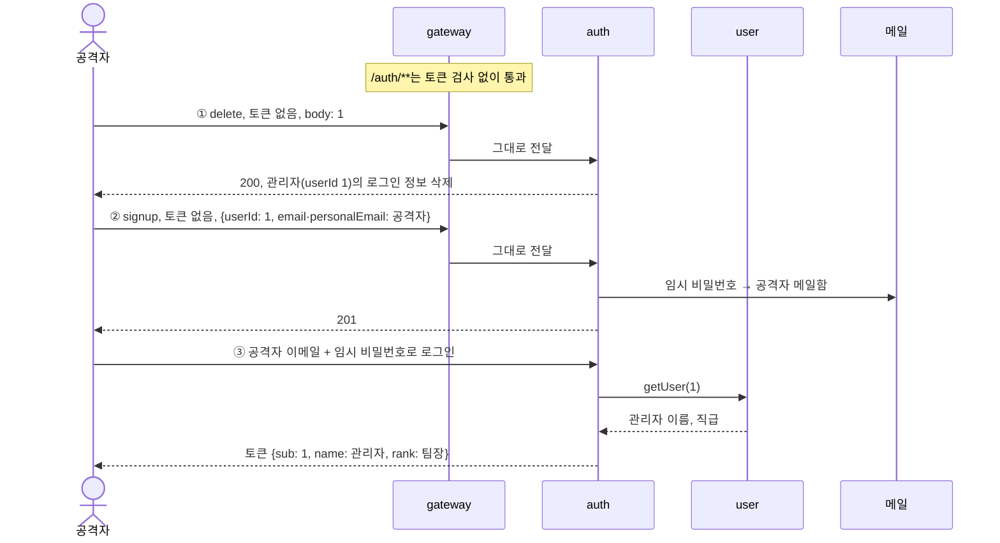
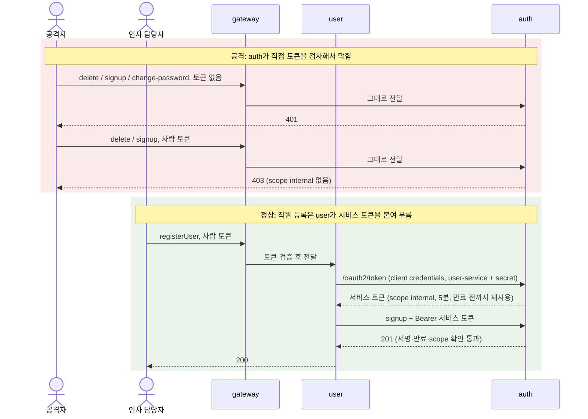

# C2·C3. auth가 호출자를 확인하지 않음 (GEA-13)

## 발견

auth에는 로그인 정보(이메일, 비밀번호, userId 연결)를 다루는 API가 세 개 있어요. 세 API 모두 auth `SecurityConfig`에서 permitAll이에요. gateway는 로그인 화면과 토큰 발급 때문에 `/auth/**`를 검증 없이 통과시켜요. 결국 **gateway도 auth도 검사하지 않아서** 누구나 gateway를 거쳐 부를 수 있어요.

| API | 원래 호출자 | 문제 |
|---|---|---|
| `POST /auth/api/v1/auth/delete` (C2) | user 서비스(Feign) | body의 `userId`만으로 로그인 정보를 지워요. userId가 순번이라 하나씩 올리면 모든 직원이 로그인을 못 해요 |
| `POST /auth/api/v1/auth/signup` (후보) | user 서비스(Feign) | body의 `userId`, `email`, `personalEmail`을 그대로 저장하고, 임시 비밀번호를 `personalEmail`로 보내요. 공격자 주소를 넣으면 공격자에게 가요 |
| `POST /auth/api/v1/auth/change-password` (C3) | 로그인한 본인(프론트) | 본인 확인을 토큰이 아니라 body의 `userId`로 해요. 현재 비밀번호가 틀려도 횟수 제한이 없어서 남의 비밀번호를 끝없이 맞춰 볼 수 있어요 |

### 연쇄 공격: 관리자 계정 탈취

토큰은 auth의 `Auth.userId`로 user에서 사람 정보를 가져와 만들어요(`JwtCustomizerConfig`). 그래서 연결표의 userId만 바꿔치기하면 다른 사람의 토큰이 나와요.

1. delete로 관리자(userId 1)의 로그인 정보를 지워요.
2. signup으로 `{userId: 1, email: 공격자, personalEmail: 공격자}`를 만들어요. 임시 비밀번호가 공격자 메일로 와요.
3. 공격자가 그 비밀번호로 로그인하면 `sub=1`, 관리자 이름과 직급이 담긴 토큰이 나와요.



### 공통 원인

auth가 **"누가 불렀는지"를 확인하지 않아요.** gateway 주석에는 "auth 안의 보안 설정이 각 엔드포인트를 직접 지킨다"고 적혀 있지만, 이 세 API는 그 약속이 지켜지지 않았어요.

재현: 로컬 compose(고치기 전 코드 `ac445aa`)에서 gateway를 거쳐 위 연쇄 공격을 그대로 해 봤어요. 테스트용 직원(userId 2)을 등록한 뒤, 토큰 없이 delete(200) → 같은 userId로 공격자 메일 signup(201, Mailpit의 공격자 메일함에 임시 비밀번호 도착) → 공격자가 로그인하자 `sub=2`, 피해자 이름·직급이 담긴 토큰이 나왔어요. 토큰 없이 body의 userId만으로 change-password도 200이었어요. 결과는 아래 증명 표에 있어요.

## 선택지

### change-password (본인 확인)

| | 방법 | 장점 | 단점 |
|---|---|---|---|
| A-1 | auth가 JWT를 직접 검증해요(resource server). body의 `userId`를 지우고 토큰의 `sub`를 써요 | gateway 우회와 상관없이 안전해요 | auth에 토큰 검증 설정이 새로 들어가요 |
| A-2 | gateway가 이 경로만 토큰 필수로 하고 `X-User-Id`를 넣어요. auth는 헤더를 믿어요 | user, order와 같은 방식이라 작아요 | 운영 ingress가 gateway를 우회하면 헤더 위조로 뚫려요 |
| B | 계정별 연속 실패 N회면 일정 시간 잠가요 | 비밀번호 대입을 막아요 | B만 쓰면 남의 userId로 일부러 실패해서 그 계정을 잠글 수 있어요(DoS) |

### signup, delete (내부 호출 확인)

| | 방법 | 장점 | 단점 |
|---|---|---|---|
| ① | gateway에서 두 경로를 403으로 막아요 | 가장 작아요. Feign은 그대로예요 | ingress 우회나 내부 Pod 호출은 막지 못해요 |
| ② | auth에 `/internal/**`을 두고 gateway에서 막아요 | 내부 API 규칙이 코드에 드러나요 | ①과 같은 한계예요. 경로가 바뀌어요 |
| ③ | client credentials. user가 auth에서 서비스 토큰을 받아 호출하고, auth가 scope를 검사해요 | 네트워크 위치와 상관없어요. 토큰이 짧게 만료돼요. 사람 토큰과 구분돼요 | 작업이 커요. 클라이언트 등록과 secret 관리가 필요해요 |
| ④ | user와 auth가 같은 비밀 문자열을 헤더(`X-Internal-Token`)로 주고받아요 | 코드가 아주 적어요 | 값이 영구 유효해서 한 번 새면 끝이에요. 누가 불렀는지 몰라요 |

## 선택: change-password는 A-1 + B, signup·delete는 ③

auth만 직접 토큰을 검증하는 이유는 [ADR 0004](../adr/0004-auth-self-verification.md)에 정리했어요. 요약하면 auth로 오는 요청은 gateway 검증을 받지 않아요(`/auth/**` 통과, Feign 직접 호출, 운영 ingress 우회 가능).

- **change-password: A-1 + B**
  - 원래 토큰을 검증했어야 하는 API예요.
  - A만 하면 비밀번호 대입이 남고, B만 하면 남의 계정을 잠그는 DoS가 생겨요. A로 "내 계정"만 시도할 수 있게 되면 B의 DoS 문제도 사라져요.
  - A-2는 운영 ingress가 gateway를 우회하면 헤더 위조로 뚫려서 제외했어요.
- **signup, delete: ③**
  - Feign 호출은 gateway를 지나지 않아서 ①과 ②로는 내부 호출을 확인할 수 없어요.
  - ④는 secret이 영구 유효해서 새면 대응할 방법이 없어요.
  - ③은 토큰이 짧게 만료되고, scope로 사람 토큰과 서비스 토큰을 구분해요.
  - auth가 이미 Authorization Server라 토큰 발급 기능을 새로 만들 필요가 없어요. 클라이언트 등록만 추가해요.
  - ③을 하면 auth에 토큰 검증 설정이 들어가고, change-password(A-1)도 같은 설정을 써요.

### ③은 이렇게 동작해요

```
[미리 한 번] auth에 클라이언트 등록: user-service / secret / scope=internal

1. user ──client_credentials(client_id, secret)──▶ auth /oauth2/token
        ◀── 서비스 토큰 (sub=user-service, scope=internal, 짧은 만료)   ※ 저장 없음, 만료 전까지 재사용
2. user ──signup + Bearer 서비스 토큰──▶ auth
3. auth: 서명(공개키) · 만료 · scope 확인 → 통과하면 저장, 아니면 401/403
```

- ③은 "토큰 받기"와 "토큰 확인하기" 두 단계예요. 받는 쪽(auth)이 토큰을 확인해야 의미가 있어서, auth에 토큰 검증이 필요해졌어요.
- 서비스 토큰은 직원이 아니라 user 서비스 자신에 대한 토큰이에요. 미리 등록한 클라이언트로 발급해서 회원 정보가 필요 없어요.
- auth는 DB 조회 없이 서명(개인키로 찍은 도장)을 공개키로 계산해서 검증해요. 만료 시각과 scope도 확인해요.

바꿀 것 (구현 때 확정):
- auth `defaultSecurityFilterChain`에 resource server(JWT) 추가. signup, delete, change-password를 permitAll에서 빼요.
- signup, delete는 `SCOPE_internal`만 허용해요.
- change-password: `ChangePasswordRequest`에서 `userId`를 빼고 토큰의 `sub`를 써요. 연속 5회 실패하면 15분 잠그고, 성공하면 초기화해요.
  - 잠금 정보는 `Auth`에 `failed_count`, `locked_until` 두 칸으로 저장해요. change-password 전용이에요. 기존 계정은 칸이 비어 있어서(null) 0으로 봐요.
  - 비밀번호가 틀리면 400, 잠겨 있으면 423이에요. 401은 쓰지 않아요(프론트가 401이면 재시도해서 실패가 2번 세져요).
- auth에 `user-service` 클라이언트를 등록해요. secret은 환경변수 `USER_SERVICE_CLIENT_SECRET`(`infra/.env`)에서 읽고, 서비스 토큰은 5분 뒤 만료돼요.
- `JwtCustomizerConfig`: client credentials 토큰이면 사람 정보 조회를 건너뛰어요. 지금은 로그인 이름을 이메일로 보고 찾아서 서비스 토큰 발급이 실패해요.
- user: Feign이 서비스 토큰을 받아 붙여요.

## 한계

- **내부망 신뢰**: user, order는 gateway가 넣은 헤더를 믿어요. gateway를 우회하는 경로가 생기면 헤더 위조가 가능해요([ADR 0004](../adr/0004-auth-self-verification.md)).
- **auth → user 호출 무검증**: 토큰을 만들 때 auth가 user를 부르는 호출(`UserClient.getUser`)에는 인증이 없어요. B1·B2 때 다시 봐요.
- **운영 ingress 미확인**: 원본 운영에서는 ingress가 `/auth`를 gateway 없이 auth로 보냈어요. GCP 배포 때 확인해요.
- **서명 키가 메모리에만 있음(E1)**: auth가 재시작하면 서명 키가 바뀌어요. user가 들고 있던 서비스 토큰이 만료될 때까지(최대 5분) 직원 등록·삭제가 실패해요. 401에 다시 받아 재시도하는 코드는 넣지 않았어요. E1에서 서명 키를 고정하면 사라지는 문제라서요.
- **`regenerate-temp-password`는 permitAll로 남겨요**: 지금은 이 API 하나가 "인사 담당자 다시 보내기"와 "사용자 비밀번호 찾기"를 같이 해요. 비밀번호를 잊은 사람은 토큰이 없어서 그냥 잠글 수 없어요. 회사 이메일만으로 남의 비밀번호를 바꿔 버리는 문제는 C6에서 고쳐요. 다시 보내기는 인사 담당자만 부르게 하고(이번에 넣은 토큰 검증을 재사용), 비밀번호 찾기는 재설정 링크 방식의 새 API로 만들어요([C1-temp-password.md](C1-temp-password.md)).
- **비밀번호 찾기를 해도 잠금은 그대로예요**: change-password가 잠긴 뒤 비밀번호 찾기로 임시 비밀번호를 받아도, 잠금이 끝날 때까지(최대 15분) 비밀번호를 바꿀 수 없어요. 드문 경우이고 C6에서 그 API가 바뀌어서 지금은 엮지 않았어요.
- **동시 요청으로 잠금 우회(C7)**: 실패 횟수를 읽고 +1 해서 저장하는 방식이라, 틀린 요청을 동시에 많이 보내면 서로 덮어써서 5번보다 많이 시도할 수 있어요. 그 사람의 토큰이 있어야 가능해요. k6 기준선 뒤에 로컬에서 재현하고 세 방법(비관적 락, DB 원자 증가, 낙관적 락)을 측정해 비교한 뒤 고쳐요. GCP 배포 전에는 반드시 고쳐요.
- **로그인 폼 대입은 남아 있어요(C8)**: 이번에 막은 건 change-password로 하는 비밀번호 대입이에요. 로그인 폼은 시도 제한이 없어요. 로그인에 같은 잠금을 걸면 남의 이메일로 일부러 틀려 그 사람을 못 들어오게 하는 DoS가 생겨서, gateway 요청 횟수 제한으로 따로 고쳐요.
- **프론트**: 프론트는 원본(Gear-First/Web-FE)을 기반으로 나중에 새로 만들어요. 원본에서 확인한 내용과 새 프론트가 지킬 것:
  - 원본 `changePassword`는 `fetchWithAuth`로 `Authorization: Bearer` 토큰을 보내고, body에 `userId`도 넣어요. 서버는 수정 후 `userId`를 무시해요. 새 프론트에서는 `userId`를 빼요.
  - 원본 `fetchWithAuth`는 401을 받으면 토큰을 갱신해서 한 번 더 보내요. 그래서 서버는 비밀번호가 틀리면 400, 잠기면 423처럼 401이 아닌 코드를 돌려줘야 해요. 401로 주면 재시도 때문에 실패 횟수가 2씩 올라가요.
  - 직원 등록 화면은 user의 `registerUser`를 불러요. auth signup을 부르는 화면은 없어야 해요.
  - 이번 증명은 프론트 없이 테스트와 curl(사용자 토큰은 Postman의 OAuth2 PKCE로 발급)로 해요.
- **순환 의존 증가**: user가 auth의 토큰 발급에도 의존하게 돼요. 구조 한계는 [ADR 0004](../adr/0004-auth-self-verification.md)에 있어요.
- **범위 밖**: 하드코딩된 기존 client secret(C5).

## 증명

### 고친 뒤 흐름



### 로컬 compose (gateway 경유, 2026-11-27)

고치기 전은 `ac445aa`(dev), 고친 뒤는 이 브랜치로 같은 스크립트를 돌렸어요. 매번 테스트용 직원을 새로 등록해 피해자로 썼어요.

| 케이스 | 고치기 전 | 고친 뒤 |
|---|---|---|
| delete, 토큰 없음 | 200, 피해자 로그인 정보 삭제 | 401 |
| delete, 사용자 토큰(팀장) | (해 보지 않음, 토큰 없이도 됨) | 403 |
| signup, 토큰 없음 + 공격자 메일 | 201, 공격자 메일함에 임시 비밀번호 | 401, 메일 없음 |
| signup, 사용자 토큰(팀장) | (해 보지 않음) | 403 |
| 연쇄 공격: 공격자 로그인 | 피해자 `sub`·이름·직급이 담긴 토큰 획득 | 비밀번호를 못 받아 시도 불가 |
| change-password, 토큰 없음 + body에 피해자 userId | 200, 피해자 비밀번호 변경 | 401 |
| change-password, 본인 토큰 + body에 다른 userId(999) | – | 200, 본인 계정만 바뀜 |
| change-password, 틀린 현재 비밀번호 5번 | – | 400 × 5 |
| change-password, 6번째(맞는 비밀번호) | – | 423 |
| 직원 등록 (user → auth signup, 서비스 토큰) | 200, 임시 비밀번호 메일 도착 | 200, 임시 비밀번호 메일 도착 |
| 직원 삭제 (user → auth delete, 서비스 토큰) | – | 200, 삭제된 직원은 로그인 실패 |

### 테스트 (H2)

- `InternalApiCallerTest` (9개): signup·delete의 토큰 없음 401, 사용자 토큰 403, 서비스 토큰 성공, 가짜 서명 401, auth가 실제로 발급한 client credentials 토큰으로 signup 성공, 틀린 client secret이면 토큰 발급 거부
- `ChangePasswordTest` (14개): 토큰 없음 401, 서비스 토큰 403, body의 남의 userId 무시, 틀리면 400, 5번 뒤 423, 성공 시 초기화, 잠금 만료 후 다시 가능, 남의 실패가 내 계정을 잠그지 않음, 잠금 칸이 빈 기존 계정, 빈 값·확인 불일치 400
- 고치기 전 코드에서 23개 중 19개가 실패했어요. 통과한 4개 중 3개는 고친 뒤에도 같아야 하는 정상 경우(서비스 토큰 성공, 틀린 secret 거부)이고, "change-password 토큰 없음 401"은 고치기 전에도 우연히 통과해서 전후 비교 증거로 쓰지 않아요(위 compose 결과로 대신해요).
- `AuthServiceTokenProviderTest` (user, 3개): 토큰을 한 번 받아 재사용, 만료가 가까우면 새로 받음, AuthClient 요청에 Bearer를 붙임
