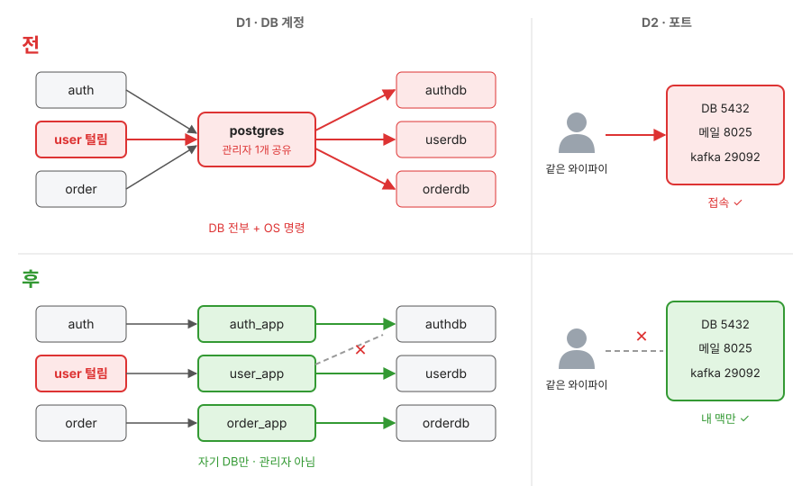
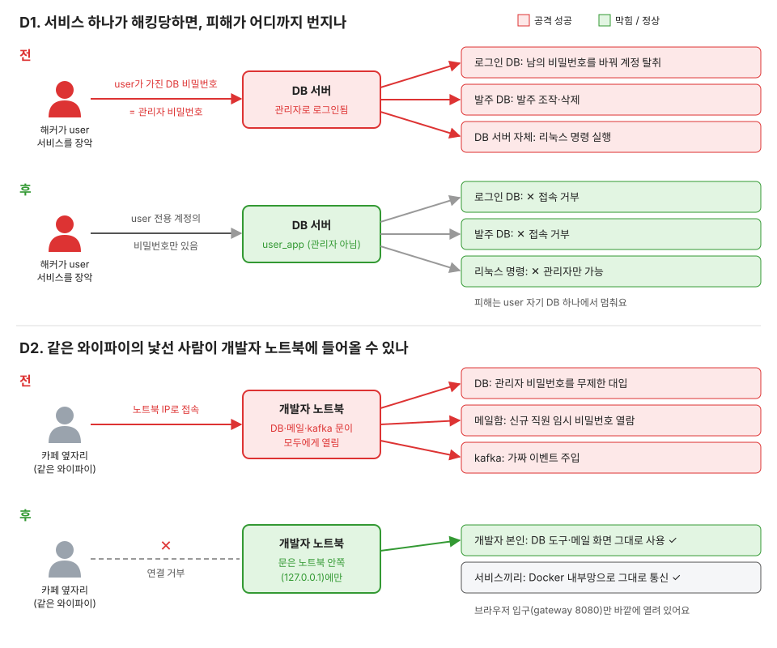

# D1·D2. DB 계정 공유와 로컬 인프라 포트 노출 (GEA-17)

## 발견

**D1.** auth, user, order가 모두 postgres **슈퍼유저** `postgres`로, 같은 비밀번호(`${POSTGRES_PASSWORD}`)로 DB에 붙었어요. 서비스 하나만 털려도(SQL 인젝션, RCE, 환경변수 유출) 피해가 그 서비스에서 끝나지 않아요.

- authdb의 비밀번호 해시를 읽고, 공격자가 아는 해시로 바꿔치기 → 본사 팀장 계정 탈취(B1·B2·C1에서 막은 걸 DB로 우회)
- orderdb 발주 변조, `DROP DATABASE`
- 슈퍼유저라서 `COPY ... TO PROGRAM`으로 postgres 컨테이너에서 OS 명령 실행. 내부 네트워크에 발을 들이면 gateway를 거치지 않고 `X-User-*` 헤더를 위조해 서비스를 직접 부를 수 있어요(A1~A3 우회)

**D2.** compose의 `ports:`에 출입구(IP)를 안 적어서 Docker 기본값인 **모든 네트워크 인터페이스**(`0.0.0.0`, `[::]`)에 열렸어요. 같은 와이파이의 누구나 붙을 수 있고, 그대로 VM에 올리면 방화벽 설정 하나에 인터넷 노출이 걸려요.

- postgres 5432: 슈퍼유저 비밀번호를 무제한 대입(postgres는 기본 잠금이 없어요)
- mailpit 8025: 임시 비밀번호 메일 전체 열람 → 새 직원 계정 가로채기(C1 우회). 1025로 가짜 메일 주입
- kafka 29092: 인증 없는 PLAINTEXT라 order·user 토픽에 가짜 이벤트 주입

ADR 0002에서 Before/After 증거를 남기려고 공유 계정을 일부러 유지했어요. 아래 Before는 그 상태에서 남긴 거예요.

## 선택지

**D1: 어디까지 막을지**

| | 방법 | 장점 | 단점 |
|---|---|---|---|
| 가 | 서비스별 계정 1개(자기 DB 소유자), 다른 DB 접속 권한 회수, 슈퍼유저 아님 | 서비스 간 격리와 슈퍼유저 제거를 init 스크립트와 설정만으로 해결. `ddl-auto: update` 그대로 | 앱 계정이 자기 DB 안에서는 DROP·ALTER 가능 |
| 나 | 가 + 서비스별 DDL 계정과 DML 계정 분리 | 자기 DB 구조 변경까지 막음 | `ddl-auto`를 못 써서 Flyway와 서비스 3개의 스키마 SQL, H2 테스트 설정 변경이 필요 |
| 다 | 나 + 테이블·컬럼별 권한 | 가장 좁은 권한 | 앱 로직과 강하게 얽혀 유지비가 큼 |

**D2: 포트**

| | 방법 | 장점 | 단점 |
|---|---|---|---|
| a | 개발용 포트를 `127.0.0.1`에만 | 내 맥의 DBeaver·IDE·Mailpit은 그대로. 한 줄씩 수정 | VM 배포 때는 따로 없애야 함 |
| b | 호스트 포트 제거 | 가장 안전 | DB·메일을 볼 때 `docker compose exec`만 가능 |
| c | 그대로 두고 배포 때 방화벽으로 | 지금 할 일 없음 | 로컬(와이파이) 노출은 남음. 리눅스에서 Docker가 ufw를 우회하는 사고가 흔함 |

**비밀번호 전달**: `.env` 변수 / Docker secrets(파일 마운트) / GCP Secret Manager(배포 때)

## 선택: D1 가, D2 a, `.env` 변수

- known-issues의 D1은 "계정 **공유**"라는 문제라서 (가)가 정확히 그 범위예요. (나)는 "DB 안에서 무엇까지 할 수 있나"라는 다른 문제라 한계로 남겼어요.
- D2는 "바깥 사람이 쓰는 문만 바깥에, 나만 쓰는 문은 내 맥에만" 원칙으로 a를 골랐어요. gateway 8080은 입구라 그대로 열어요. 서비스끼리는 원래 내부 네트워크(`postgres:5432`, `mailpit:1025`, `kafka:9092`)를 써서 영향이 없어요.
- 계정을 나눴으니 비밀번호 하나가 새도 그 서비스 DB에서 피해가 끝나요. 그래서 Docker secrets의 추가 이득(환경변수에 안 보임)은 작다고 보고 `.env` 변수로 했어요.

바꾼 것:
- `infra/init-db.sql` → `infra/init-db.sh`: `auth_app`·`user_app`·`order_app`을 LOGIN만으로 만들고 각자 DB의 소유자로 지정. 세 DB와 기본 DB `postgres`의 `CONNECT`를 PUBLIC에서 회수. 비밀번호는 psql 변수(`:'pw'`)로 넘겨 SQL에 직접 붙이지 않음
- `infra/docker-compose.yml`: 슈퍼유저 비밀번호와 계정 생성용 비밀번호는 postgres 컨테이너만, 각 서비스는 자기 `*_DB_PASSWORD`만 `DB_PASSWORD`로 받음. postgres·mailpit·kafka 포트를 `127.0.0.1:`로
- `infra/config/{auth,user,order}.yml`: `username`을 각 `*_app`으로
- `infra/.env.example`: `AUTH_DB_PASSWORD`·`USER_DB_PASSWORD`·`ORDER_DB_PASSWORD`, `openssl rand -hex 24`로 만들라는 주석(영문·숫자만 나와 `.env`·쉘·SQL에서 안 깨짐)
- `infra/verify-d1-d2.sh`: 인수 기준을 검사하는 스크립트(아래 증명)

고치기 전과 후 (빨간색이 뚫린 곳, 초록색이 고친 곳):



공격 시나리오로 보면:



적용 방법: init 스크립트는 빈 볼륨에서만 실행돼요. `.env`에 새 변수를 넣고 `docker compose down -v` 후 `up -d`. 기존 볼륨으로 띄우면 계정이 없어서 서비스가 `password authentication failed for user "auth_app"`으로 죽어요.

## 한계

- **자기 DB 안의 권한**: 앱 계정은 자기 DB의 소유자라 테이블을 DROP·ALTER할 수 있어요. 막으려면 DDL 계정과 앱 계정을 나누고 Flyway로 스키마를 관리해야 해요(선택지 나). `ddl-auto: update`를 운영에서 쓰는 문제와 함께 배포 전에 다뤄요.
- **비밀번호 보관**: 아직 `.env` 환경변수라 `docker inspect`로 보여요. 배포 때 GCP Secret Manager로 옮겨요.
- **VM 배포**: 개발용 호스트 포트(postgres, kafka, mailpit)는 VM에서는 아예 없어야 해요. 배포 이슈에서 compose를 나눌 때 다뤄요.
- **슈퍼유저 계정**: `postgres` 슈퍼유저는 남아 있어요(초기화와 관리용). 이제 내 맥(127.0.0.1)에서만 닿아요.
- **자동화 범위**: 검증 스크립트는 떠 있는 compose가 필요해서 CI에서는 돌지 않아요. 서비스 테스트는 H2라 DB 권한을 검사할 수 없어요.

## 증명

`cd infra && ./verify-d1-d2.sh` — 인수 기준 AC1~AC14 중 자동 검사 항목을 돌리고, 하나라도 어긋나면 종료 코드 1이에요. 비밀번호는 출력하지 않아요.

### Before (공유 슈퍼유저, 모든 인터페이스에 포트 열림)

| # | 확인 | 결과 |
|---|---|---|
| 1 | `docker compose ps postgres` | `0.0.0.0:5432->5432/tcp, [::]:5432->5432/tcp` |
| 2 | `nc -vz <와이파이 IP> 5432` / `8025` / `29092` | 모두 `succeeded!` |
| 3 | user 컨테이너의 `DB_PASSWORD`로 authdb 조회 | `current_user=postgres`, `superuser=t`, auth 계정 이메일과 `$2a$10$` 해시가 보임 |
| 4 | 같은 비밀번호로 `COPY (select 1) TO PROGRAM 'id'`, `\l` | `COPY 1`(OS 명령 실행), 세 DB 모두 Owner `postgres`, 접근 권한 칸이 비어 있음(PUBLIC 접속 허용) |
| 5 | `curl <와이파이 IP>:8025/api/v1/messages` | 임시 비밀번호 메일 목록이 보임(`total: 5`, 보낸 사람 `GearFirst 운영팀`) |
| 6 | 검증 스크립트(수정 전) | `PASS 10 / FAIL 36` (PASS는 gateway 열림, localhost 접속, 컨테이너 running뿐) |

재현 명령(3): 같은 네트워크의 임시 psql로 접속해야 비밀번호를 실제로 검사해요. postgres 컨테이너 안의 psql은 trust라 증거가 되지 않아요.

```bash
docker run --rm --network gearfirst_default -e PGPASSWORD="$(docker compose exec -T user printenv DB_PASSWORD)" postgres:16 psql -h postgres -U postgres -d authdb -c "select current_user, email, left(password,7) from auth limit 3;"
```

### After

| # | 확인 | 결과 |
|---|---|---|
| 1 | `docker compose ps` | postgres `127.0.0.1:5432`, mailpit `127.0.0.1:1025`·`127.0.0.1:8025`, kafka `127.0.0.1:29092`. gateway만 `0.0.0.0:8080` |
| 2 | 와이파이 IP로 5432·8025·1025·29092 | 모두 거부. `localhost`로는 접속 |
| 3 | `user_app`으로 authdb | `FATAL: permission denied for database "authdb"` / `User does not have CONNECT privilege.` |
| 4 | `user_app`으로 `COPY ... TO PROGRAM` | `ERROR: permission denied to COPY to or from an external program` |
| 5 | 권한 표 | `authdb auth_app {=T/auth_app,auth_app=CTc/auth_app}` (PUBLIC에는 TEMP만, CONNECT 없음). userdb·orderdb·postgres도 같은 형태 |
| 6 | 검증 스크립트 | `PASS 50 / FAIL 0 / SKIP 0` |

검증 스크립트가 함께 확인하는 것: 세 계정 × 다른 DB 3개(기본 DB 포함) 접속 거부, 자기 DB 접속과 자기 테이블 존재, `rolsuper`·`rolcreaterole`·`rolcreatedb` 모두 false, 틀린 비밀번호 거부, 서비스가 슈퍼유저 비밀번호를 받지 않음, 서비스별 비밀번호가 서로 다름, 7개 컨테이너 running.
